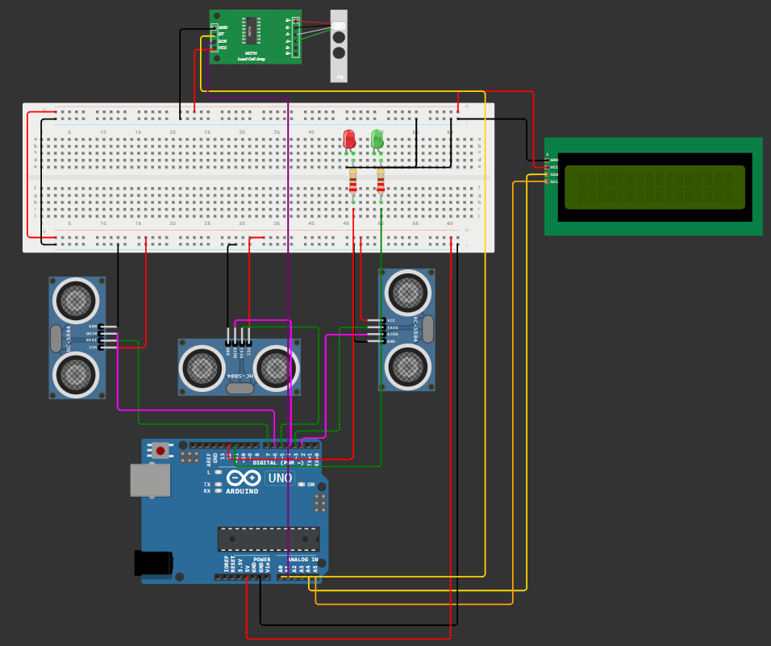

  

### Estación Automática de Pesaje, Medición y Clasificación Logística con Arduino

  <em>Prototipo embebido de bajo costo para agilizar el pre-despacho de encomiendas mediante sensores ultrasónicos y celda de carga.</em>

[Ver Simulación en Wokwi](https://wokwi.com/projects/480774529884732417) • [Descargar .ZIP](./SmartPack_Wokwi.zip) • [Diagrama de Flujo (Draw.io)](https://drive.google.com/file/d/1pIEoqswy1M_Hzw6yX6aA2bJLEoK9UKYj/view?usp=sharing)

---

## Sobre el Proyecto

En el sector logístico, medir y pesar paquetes manualmente genera cuellos de botella en los mostradores y errores humanos al calcular tarifas. **SmartPack** automatiza este proceso mediante una estación embebida capaz de:

1. **Medir dimensiones (X, Y, Z):** Calcula largo, ancho y alto al instante utilizando 3 sensores ultrasónicos.
2. **Pesar la encomienda:** Obtiene el peso exacto mediante una celda de carga de 10 kg y un módulo HX711.
3. **Clasificar y tarifar:** Categoriza el paquete (*Pequeño, Mediano, Grande o Exceso*) y calcula el costo de envío.
4. **Feedback visual:** Muestra los resultados en una pantalla **LCD 16x2 I2C** e indica mediante **LEDs** si el paquete es aceptado (Verde) o rechazado por exceso (Rojo).

---

## Componentes Utilizados

| Categoría | Componente | Cantidad | Función Principal |
| :--- | :--- | :---: | :--- |
| **Controlador** | Arduino Uno R3 + Cable USB tipo A/B | 1 | Procesamiento central, lógica del sistema y alimentación desde PC |
| **Sensores** | Ultrasónico HC-SR04 (4 pines) | 3 | Medición de distancia en ejes X, Y, Z (Ancho, Largo y Alto) |
| **Sensores** | Celda de carga (10 kg) + Módulo HX711 | 1 | Detección de peso y conversión analógico-digital de 24 bits |
| **Interfaz** | Pantalla LCD 16x2 con módulo I2C | 1 | Visualización de medidas, categoría y tarifa en tiempo real |
| **Indicadores** | LED Verde + LED Rojo + Resistencias 220Ω | 2 | Señalización visual de paquete aceptado o rechazado (con protección) |
| **Estructura** | Cajas de cartón (base y superior a 90°) | 2 | Contención de la electrónica y área de pesaje y medición |
| **Conexiones** | Protoboard (400 puntos) + Cables Jumpers (M-M / M-H) | 1 kit | Distribución de energía e interconexión de sensores y placa |

---

## Diagrama de Conexiones Físicas

Esquema del circuito armado en protoboard y conexión de pines hacia la placa Arduino Uno R3:

  
   
  <i>Esquema de conexiones físicas (Wokwi).</i>

---

## Lógica de Programación (Diagrama de Flujo)

El flujo principal del código (`loop()`) gestiona la lectura continua de los sensores, aplica las condiciones de validación y actualiza la interfaz de salida.

  
   
  <a href="https://drive.google.com/file/d/1pIEoqswy1M_Hzw6yX6aA2bJLEoK9UKYj/view?usp=sharing" target="_blank">
    <strong>🔗 Abrir diagrama interactivo en Draw.io</strong>
  </a>

---

## Archivos y Simulación

Para probar o replicar el proyecto, se puede acceder directamente a la simulación en línea o descargar el paquete completo con el código fuente (`.ino`), el esquema del circuito (`diagram.json`) y las librerías (`libraries.txt`):

| Recurso | Descripción | Enlace |
| :--- | :--- | :---: |
| **Simulación Online** | Entorno interactivo en Wokwi listo para ejecutar | [Abrir en Wokwi](https://wokwi.com/projects/479675410614874113) |
| **Paquete del Proyecto** | Contiene `SmartPack.ino`, `diagram.json` y `libraries.txt` | [Descargar .ZIP](./SmartPack_Wokwi.zip) |

---

  Desarrollado para <strong>Integración Tecnológica</strong> — 2026

